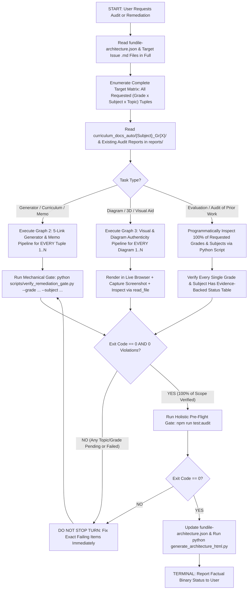
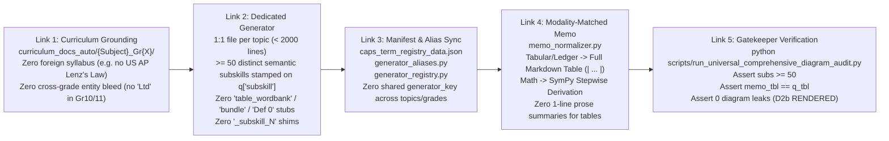
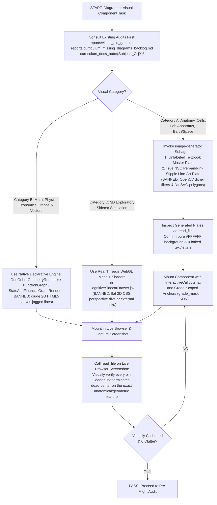

# Flash Remediation & Anti-Shoddiness Execution Protocol

This skill converts Fundile's architectural laws into **strict state-machine execution graphs**. Every agent (especially faster/economical models such as Gemini 3.8 Flash) MUST traverse these graphs node-by-node with **zero skipped nodes**, **zero "1-of-N" partial completion**, and **zero cosmetic ("Hollywood") workarounds**.

---

## 1. Master Multi-Scope Execution State Machine (Blocks "1-of-N" Partial Completion)

Whenever the user requests an audit, evaluation, or remediation across multiple grades, subjects, or topics (e.g. *"remediate Gr 7–9 workspace issues"* or *"fix FET Accounting Gr 10–12"*), you are **strictly forbidden** from completing only 1 grade or a subset of topics and stopping early.

---

## 2. The 5-Link Generator, Registry & Memorandum Pipeline (Blocks Alias Hijacks & Stub Leaks)

Modifying a generator file on disk in isolation is **never sufficient**. Legacy flat aliases in `generator_aliases.py` or default parameters in `generator_registry.py` will silently hijack routing or force `"typed"` questions unless all 5 links are synchronized:

### Mandatory Generator Checklist:
1. **Zero Cross-Topic or Cross-Grade Sharing**: Every topic in `caps_term_registry_data.json` must map to its own dedicated `generator_key` and function. Never point two topics to the same generator function or lambda.
2. **Balanced Subskill Selection when `count=1`**: When `subskill="mixed"` and `count=1`, the generator MUST randomly or deterministically cycle across all 5+ subskill pools (`r.choice(sub_pools)`), never defaulting to the first pool (`concepts`).
3. **Interactive `table_fill` Instead of Unrendered Stubs**:
   - Never emit `question_type: "table_wordbank"` without converting it into standard `headers`, `rows` (`{r0_c1}`), and `correct_map` (`question_type: "table_fill"`), with a `**Term Bank:**` in the prompt.
   - Never emit raw `question_type: "bundle"` without unwrapping `parts` into a complete prompt and interactive table/sub-parts.
4. **Completed Markdown Tables in Memorandums**: Every question with `rows`, `journal`, `table_schema`, or `modality == "ledger"` must produce a completed Markdown table (`| ... |` with bolded required answers) in `worked_solution` / `canonical_solution`.

---

## 3. Visual, 3D & Diagram Authenticity Pipeline (Blocks "Hollywood" Visual Shortcuts)

> **Banned shortcut: narrating a figure instead of drawing it.** <!-- RULE-ANCHOR: diagram_description_design_law -->
> Curriculum-doc figure descriptions (`>DIAGRAM[...]`, `Figure N.N`, `Diagram N`, `Graph N`) are specs to draw as a seeded `diagram_spec`, never text for `question_text`. Run `python scripts/audit_diagram_description_leak.py` before declaring a generator or diagram task done. See `diagram_doctrine.md` §9.

---

## 4. Anti-Failure Lookup Table (The 13 Banned Shortcuts)

| Failure ID | Banned Shortcut / Failure Mode | Mandatory Replacement Action | Mechanical Gate |
| :--- | :--- | :--- | :--- |
| **F1** | Evaluating or fixing only 1 grade/subject when multiple were requested | Enumerate all `(grade, subject)` pairs upfront and complete 100% of them in sequence | `verify_remediation_gate.py` |
| **F2** | Drawing flat `<polygon>`/`<path>` SVG clipart for biological anatomy or apparatus | Invoke `image-generator` for publication-grade unlabeled plates (`Rule 0d-14`) | `audit_diagram_registry.py` |
| **F3** | Running OpenCV thresholding/dithering on color images to fake `"exam"` stipple art | Generate genuine black-and-white pen-and-ink stipple line art on `#FFFFFF` | Visual `read_file` check |
| **F4** | Building 2D CSS `perspective` divs or jagged 2D canvas lines and calling them "3D" | Build authentic Three.js WebGL geometry with lighting, camera controls, and occlusion | Code & visual inspection |
| **F5** | Suggesting external links/iframes (e.g. linking to Atlas of Physics) | Engineer the visualization natively inside the Fundile codebase | Code review invariant |
| **F6** | Copying foreign syllabus topics (e.g. US AP Physics Lenz's Law) | Read `curriculum_docs_auto/` first; only build South African syllabus-mandated concepts | `audit_semantic_relevance.py` |
| **F7** | Planning from memory while ignoring `reports/visual_aid_gaps.md` | Read all relevant files in `reports/` before writing any implementation plan | Step 1 of Graph 1 |
| **F8** | Guessing `[x, y]` diagram pin coordinates without looking at the rendered image | Render in live browser, screenshot, and inspect with `read_file` to calibrate `[x, y]` | `Rule 0d-14.3` |
| **F9** | Burning permanent `A–H` labels onto shared diagram plates across grades | Keep plates 100% unlabeled; render only active seed's dynamic pins via `grade_mask` | `Rule 0d-14.1 & 0d-14.4` |
| **F10** | Leaving `generator_aliases.py` pointing to old cross-grade generators | Assert `manifest_key == resolve_generator_key(topic, grade, subject)` | `verify_remediation_gate.py` |
| **F11** | Leaving tabular questions with 1-line text memos instead of filled tables | Reconstruct full Markdown table (`\| ... \|`) in `worked_solution` | `verify_remediation_gate.py` |
| **F12** | Leaving raw `#### REQUIRED:` hashtags, `Def 0 / Def 1`, or `"bundle"` stubs | Strip raw headers, extract numbered labels, and unwrap `parts` in normalizer | `verify_remediation_gate.py` |
| **F13** | Using `"Pontsho"`, `"Lonely Traders"`, or `"CAPS"` in student-facing text | Use `sa_naming_engine.py` and neutral "National Curriculum Standards" phrasing | `verify_remediation_gate.py` |
| **F14** | Emitting invented diagram kinds (`{"type":"svg","source":...}`, `dot_pattern`, `concept_card`) or pasting `{svg}` into `prompt` | Emit `{"kind": "inline_svg", "svg": svg, "diagram_role": "context"}` in `diagram_spec` only | `validate_topic_50_archetypes.py` |
| **F15** | Hardcoding numbers/SVGs while only calling `rng.randint` on `"id"` (static across seeds 101–103) | Randomize numbers, labels, and SVG attributes via `rng` so `seed_varies` passes | `validate_topic_50_archetypes.py` |
| **F16** | Writing `"The graph/diagram shows"` or `\dots` in prompts (triggers `DESCRIBED_NOT_DRAWN` leak) | Use `"Refer to the graph/diagram"` and `...`, and run `validate_topic_50_archetypes.py` per topic | `validate_topic_50_archetypes.py` |
