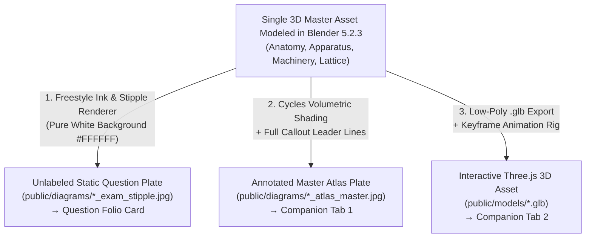

# Fundile Diagram Doctrine
**Authoritative Architectural, Pedagogical & Engineering Standard for All Visual Assets (Grades 7–12)**

---

## 1. Core Governing Law: Separation of Concerns

Fundile enforces an unbreachable operational boundary between how a learner is **assessed** and how a learner **conceptualizes and remediates**:

```
┌─────────────────────────────────────────────────────────────────────────────────────────────┐
│                                 FUNDILE DIAGRAM ARCHITECTURE                                │
├──────────────────────────────────────────┬──────────────────────────────────────────────────┤
│        SURFACE 1: ASSESSMENT             │             SURFACE 2: REMEDIATION               │
│        (Question Folio Card)             │        (The Merged Enhancement Companion)        │
├──────────────────────────────────────────┼──────────────────────────────────────────────────┤
│ • 100% Static, 2D Examination Figures.   │ • Single dedicated companion per archetype.      │
│ • Locked parameters, coordinates & terms.│ • Tab 1: Static Fully Annotated Master Atlas.    │
│ • Dynamic pin isolation (only tested pins│ • Tab 2: Live Interactive Simulation & Process.  │
│   render; zero generic letter clutter).  │ • Live coefficient sliders (a, b, c, d), dynamic │
│ • Archival Paper Folio UI (#FAF8F3).     │   vertex gliders, 3D orbits, formula popovers.   │
│ • Evaluated for marks & progression.     │ • Strictly UNGRADED exploratory laboratory.      │
└──────────────────────────────────────────┴──────────────────────────────────────────────────┘
```

---

## 2. Mathematics Doctrine: The Dual-Capacity Standard

Mathematics learning requires bridging the gap between static symbolic representations on paper and the dynamic spatial/functional relationships they represent.

### 2.1 Cartesian Functions & Polynomials
* **In the Question Card (Assessment Surface — 100% Static):**
  - All graphs (linear, quadratic parabolas $y=a(x-p)^2+q$, hyperbolas $y=\frac{a}{x-p}+q$, exponential $y=a\cdot b^{x-p}+q$, cubics $y=ax^3+bx^2+cx+d$, and trigonometric curves $y=a\sin(kx)$) are **rendered strictly as static, locked 2D figures**.
  - Graphs display exact, locked landmarks according to the question seed: labeled intercepts, turning points $(p, q)$, asymptotes, or given coordinate points. No sliders or draggable nodes exist in the question card.
* **In the Enhancement Companion (Remediation Surface — Dual Capacity):**
  - **Tab 1 (Annotated Master Atlas):** A static high-resolution master plot displaying all algebraic and calculus features simultaneously: domain, range, $x$- and $y$-intercepts, axis of symmetry, stationary turning points ($f'(x) = 0$), point of inflection ($f''(x) = 0$), intervals of increase/decrease, and concave up/down regions with their formal NSC criteria.
  - **Tab 2 (Live Interactive Simulation & Parameter Engine):**
    - **Live Coefficient Sliders ($a, b, c, d$ or $a, p, q, k$):**
      * **The $a$ slider:** Moving $a$ dynamically steepens/flattens the curve and inverts concavity ($a > 0$ vs. $a < 0$), visually demonstrating vertical stretch and reflection across the $x$-axis.
      * **The $p$ and $q$ sliders:** Demonstrates horizontal ($x \to x-p$) and vertical ($y \to y+q$) rigid translations in real time.
      * **Drifting Landmarks:** As coefficients change, roots, vertices, and asymptotes recalculate and drift smoothly across the coordinate grid.
    - **The Dynamic Derivative Tangent Scrubber:** A draggable point $x_0$ along the curve with a live tangent line displaying $m = f'(x_0)$ and the difference quotient limit as $h \to 0$, connecting algebraic differentiation to geometric slope.

### 2.2 Euclidean Geometry
* **In the Question Card (Assessment Surface — 100% Static):**
  - Renders a clean, locked geometric figure representing the exact given problem statement.
  - Labeled with standard examination vertices ($A, B, C, D$), given angles ($\hat{B}_1 = 34^\circ$), and construction markings (parallel arrows, equal tick marks). The figure is rigid and unmovable.
* **In the Enhancement Companion (Remediation Surface — Dual Capacity):**
  - **Tab 1 (Annotated Master Atlas):** The complete reference theorem figure with all geometric properties highlighted (e.g., cyclic quadrilateral opposite angles color-coded to sum to $180^\circ$, tangent-chord angle highlighted with its subtended arc) along with official South African examination reason codes (e.g., `opp \angle s of cyclic quad`, `\angle in semi-circle`, `tan-chord theorem`).
  - **Tab 2 (Live Dynamic Vertex Gliders):**
    - The student drags vertex $C$ freely along the circumference of the circle:
      * **Angles in the Same Segment:** As $C$ slides anywhere along the major arc, the numerical readout for $\angle ACB$ stays locked at $42^\circ$, proving that subtended angles do not change with position.
      * **Angle at Centre:** A connected central angle $\angle AOB$ updates in real time to show it remains exactly $2 \times \angle ACB = 84^\circ$.
    - The theorem transitions from a dry phrase memorized from a textbook into an immutable, physically experienced geometric law.

### 2.3 Number Patterns & Sequences
* **In the Question Card (Assessment Surface — 100% Static):**
  - Displays the first three or four stages of a geometric pattern (e.g., matchstick triangles, tiled squares, dot arrays) as static, discrete drawings alongside the sequence values ($T_1, T_2, T_3$).
* **In the Enhancement Companion (Remediation Surface — Dual Capacity):**
  - **Tab 1 (Annotated Master Atlas):** Comprehensive visual decomposition table showing the stage index $n$, visual breakdown (constant core vs. growing perimeter), first difference $\Delta_1$, and constant second difference $d = 2a$ leading to the general term $T_n = an^2 + bn + c$.
  - **Tab 2 (Live Interactive Growth Scrubber):**
    - A stage slider ($n = 1 \dots 50$): As the slider scrubs forward, new elements are visibly added in contrasting ink colors, dynamically plotting the point $(n, T_n)$ on a synchronized Cartesian sequence graph.

### 2.4 3D Mensuration & Geometric Nets
* **In the Question Card (Assessment Surface — 100% Static):**
  - Static 2D isometric wireframe drawing of the 3D solid (cube, prism, pyramid, cylinder, cone) with given dimensional labels ($r, h, l, w$).
* **In the Enhancement Companion (Remediation Surface — Dual Capacity):**
  - **Tab 1 (Annotated Master Atlas):** Fully unfolded 2D net layout with color-coded surface areas mapped directly to the total surface area ($TSA$) formula and volume equations.
  - **Tab 2 (Live 3D Folding Canvas):**
    - A 3D folding slider ($0\% \to 100\%$): Unfolds the 3D solid into its 2D net and folds it back up in real-time WebGL, allowing students to inspect which edges meet and which faces are identical.
    - Hovering any face triggers `CalculationPopoverCard` showing that specific face's area contribution.

---

## 3. Physical Sciences & Chemistry Doctrine

### 3.1 Mechanics & Free-Body Diagrams
* **Question Card:** Clean static 2D Free Body Diagram (FBD) with labeled force arrows ($\vec{F}_g, \vec{F}_N, \vec{f}_k, \vec{F}_{\text{applied}}$) originating from a central dot on a locked coordinate plane.
* **Enhancement Companion:**
  - **Tab 1:** Complete force resolution diagram showing the orthogonal decomposition of gravity ($F_{g\parallel} = mg\sin\theta$, $F_{g\perp} = mg\cos\theta$).
  - **Tab 2:** 3D Paper & Ink inclined plane with real-time angle slider ($\theta = 0^\circ \dots 60^\circ$): As $\theta$ increases, the normal force arrow visibly shrinks while the parallel gravity arrow grows. Click/hover on any vector displays live numerical substitution:
    $$\theta = 30^\circ, m = 4\text{ kg} \implies F_{g\parallel} = (4)(9.8)\sin(30^\circ) = 19.6\text{ N}$$

### 3.2 Electric Circuits
* **Question Card:** Clean static 2D circuit schematic (resistor zigzags, battery cells, switches, voltmeters, ammeters) with fixed component values.
* **Enhancement Companion:**
  - **Tab 1:** Color-coded circuit topology map distinguishing series vs. parallel branches with current node rules ($I_{\text{total}} = I_1 + I_2$) and loop voltage equations.
  - **Tab 2:** 3D Paper & Ink Circuit Elevation loop where vertical height $y \propto V(x)$. Shows electron particles decelerating inside high-resistance zones (Joule heating $P = I^2R$) and the lost volts drop ($Ir$) across internal resistance.

### 3.3 Matter, Lattices & Chemistry Apparatus
* **Question Card:** Static Category A textbook/stipple plate for apparatus (titration burette, distillation glassware, galvanic cell) or static Bohr model.
* **Enhancement Companion:**
  - **Tab 1:** Fully labeled master apparatus plate with indicator transition zones, half-cell potentials ($E^\circ$), and redox half-reactions.
  - **Tab 2:** 3D WebGL particle chamber (kinetic molecular theory phase transitions with latent heat plateaus) and 3D crystal lattice explorer ($\text{NaCl}$ hydration, Diamond $sp^3$ vs. Graphite $sp^2$ electron delocalization, VSEPR molecular shape morphing).

---

## 4. Life Sciences & Biology Doctrine (The Heart Standard / Rule 0d-14)

### 4.1 Zero-Clip-Art Law
Synthetic SVG geometric approximations (`<polygon>`, `<ellipse>`, flat gradients) representing organic biological anatomy, cytology, or histology are permanently banned. Every biological figure must utilize authentic, publication-grade illustrations (Campbell Biology / OpenStax standard) centered on solid white (`#FFFFFF`).

### 4.2 Multi-View Synchronized Architecture
Every biological master supports three synchronized views:
1. **View 1 (Textbook Master):** 3D volumetric depth and realistic anatomical tissue cross-section shading.
2. **View 2 (NSC Exam Stipple):** Authentic past-paper black-and-white stipple dot-shading and fine cross-hatching.
3. **View 3 (Process / Live Simulation):** Dynamic functional movement (e.g., cardiac cycle blood flow, peristalsis muscle contraction wave, eye accommodation lens thickening).

### 4.3 Question Card Lock
In student question cards, the component is **permanently locked to a single view** (either Textbook or Exam Stipple as prescribed by `diagram_spec.view`). View switching is strictly isolated to the Enhancement Companion.

---

## 5. Question-Dedicated Pin Isolation Standard (Anti-Copy-Paste Law)

To ensure diagrams feel custom-authored for each question rather than copied from a generic repository:

1. **100% Unlabeled Base Assets:** Base image plates in `public/diagrams/` contain **zero baked-in letters, numbers, callout lines, or text**.
2. **Dynamic Seed Filtering:** The React SVG overlay (`InteractiveCallouts.jsx`) dynamically filters the coordinate anchor manifest (`diagram_anchors/<diagram>.json`), rendering **only the specific pin letters referenced by the active question prompt**:
   - If Question 1.1 asks: *"Identify valve A and chamber B"*, **only pins A and B appear on the diagram**. All other structures have zero callouts.
   - If the next seed asks about the aorta, only a single pin appears on the aorta.
3. **Cross-Grade Scope Isolation (`grade_mask`):** Senior Phase (Grades 7–9) questions never display FET-level (Grades 10–12) histological or ultrastructure pins.
4. **Anti-Leak Security:** Answers and anatomical names never appear in DOM attributes or network payloads prior to evaluation. Generators emit opaque tokens (`ref_1`, `pin: "A"`).

---

## 6. The Unified Enhancement Companion Architecture

The separate Visual Aid Drawer and SimuLearn Player are unified into a single, cohesive **Enhancement Companion** per archetype:

```
┌────────────────────────────────────────────────────────────────────────┐
│  ENHANCEMENT COMPANION: [Archetype Title]                              │
│  [ 📖 View 1: Annotated Master Atlas ] [ ⚡ View 2: Live Simulation ]   │
├────────────────────────────────────────────────────────────────────────┤
│                                                                        │
│  TAB 1: ANNOTATED MASTER ATLAS (Static Full Reference)                 │
│  • High-resolution, fully labeled master plate or theorem schematic.   │
│  • Every anatomical part, geometric angle, or circuit node labeled.    │
│  • Curriculum definitions, functions, and exam traps glossary.         │
│                                                                        │
│  TAB 2: LIVE SIMULATION & WORKED PROCESS (How It Actually Works)       │
│  • Interactive parameter sliders (coefficients, angles, temperatures). │
│  • Dynamic vertex gliders, 3D orbits, and live micro-physics.          │
│  • Choreographed SimuLearn step-by-step worked solution replay.        │
│  • Click/Hover Formula Popovers (Formula → Substitution → Result).     │
│                                                                        │
└────────────────────────────────────────────────────────────────────────┘
```

---

## 7. The Production Foundry: Blender 5.2.3 MCP & Vector Engines

Blender 5.2.3 (connected via MCP on `localhost:9876`) operates as Fundile's **central offline asset foundry**:



* **Zero Runtime Overhead:** Blender never runs in the student's browser. It models the system once and exports static 2D plates and lightweight 3D `.glb` assets.
* **Top Backlog Priority:** Missing masters from `curriculum_missing_diagrams_backlog.md` (DNA replication, human skeleton, brain structure, electromagnetic induction, flower anatomy) are authored through this pipeline.

---

## 8. The Paper Folio Workspace Standard (Archival Stationery)

The visual design of the question solving canvas in `UniversalWorkspace.jsx` rejects sterile corporate SaaS grids:

1. **Archival Paper Canvas:** The problem card uses a warm off-white paper canvas (`#FAF8F3` / `#FDFBF7`) with soft stone borders (`#EAE5DC`).
2. **Charcoal Typography:** Problem prose and mathematical notation use warm `#1E2022` charcoal ink rather than harsh, fatiguing jet black (`#000000`).
3. **Seamless Embedded Figures:** Diagrams rest flush on the paper canvas as if printed with dark archival ink—free of extraneous bounding frames, gradient headers, or dark borders.
4. **Color-Coded Semantic Term Binding:** Algebraic variables in worked solutions and hints share the exact color of their corresponding diagram elements (e.g., parallel gravity $F_{g\parallel}$ is amber in both the KaTeX formula and on the diagram arrow).

---

## 9. Diagram Description → Design Law (Curriculum Docs Are Figure Specs)

<!-- RULE-ANCHOR: diagram_description_design_law -->
`curriculum_docs_auto/` was converted from PDF. Every original figure (map, plan, graph, bill, meter, tree diagram, apparatus) became a **text description**, because Markdown cannot carry the image. Recognisable forms include `>DIAGRAM[ … ]`, `Figure N.N: …`, `**Diagram N**`, `### Graph N: …`, and narrated layouts or measurements (e.g. *"Diagram 3: Measured width = 3 cm"*).

1. **A description is a design spec, not prompt text.** When a generator draws on such a block, it MUST emit a structured, seeded `diagram_spec` carrying the figure's parameters (dimensions, positions, scale, data series, labels), rendered by a native engine (Approach B) or a plate (Approach A).
2. **The question refers to the figure; it does not narrate it.** Write "Use the floor plan below…", never "A rectangular room 4,2 m by 3,6 m has a door on the north wall…" as a substitute for the figure.
3. **Copying or paraphrasing a figure description into `question_text` is a defect** (`DESCRIBED_NOT_DRAWN`). Detector: `python scripts/audit_diagram_description_leak.py`.
4. **Exception: decorative photos** with no data needed to answer (e.g. *"Figure 5.1: SALT Telescope, Sutherland"*) need no figure and must not be narrated either.
5. Applies to every subject and grade, for new generators and for remediation.

---

## Summary Checklist for Any Diagram Implementation
- [ ] **Assessment Card**: Is the diagram 100% static, 2D, and free of sliders or animations?
- [ ] **Pin Isolation**: Are *only* the specific letters referenced by the active question prompt visible?
- [ ] **Zero Clip-Art**: Is the underlying illustration a publication-grade plate (not hand-coded SVG polygons)?
- [ ] **Enhancement Companion**: Does the archetype provide both Tab 1 (Annotated Reference) and Tab 2 (Live Process)?
- [ ] **Mathematics**: Do polynomial and geometric simulations provide dynamic parameter sliders ($a, b, c, d$) or vertex gliders?
- [ ] **Workspace Surface**: Does the question card adhere to the `#FAF8F3` Paper Folio aesthetic?
- [ ] **Description → Design (§9)**: Was every curriculum-doc figure description turned into a drawn `diagram_spec` rather than narrated in the prompt?
