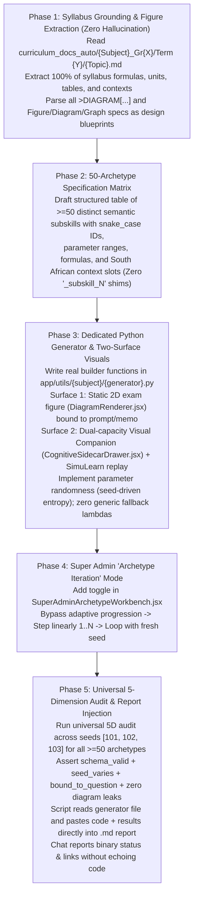

# Master Reusable Workflow: 50-Archetype Expansion, Two-Surface Visuals & Linear Iteration Engine

> **Scope**: Standard operating protocol for expanding any curriculum topic across Senior Phase (Grades 7–9) and FET Phase (Grades 10–12) to **$\ge 50$ distinct, authentic archetypes** with generative entropy, Super Admin linear iteration, two-surface diagram doctrine enforcement, SimuLearn step-by-step replays, and token-conserving report generation.

---

## 1. The 5-Phase Reusable Execution Architecture

---

## 2. Phase-by-Phase Execution Details

### Phase 1: Syllabus Grounding & 3-Tier Source Hierarchy (Zero Hallucination)
1. **Mandatory 3-Tier Source Escalation**:
   - **Tier 1 (`curriculum_docs/`)**: Consult `curriculum_docs/{Subject}/` first to verify official syllabus topic boundaries, teacher pacing guidelines, and term allocations.
   - **Tier 2 (`curriculum_docs_auto/`)**: Consult `curriculum_docs_auto/{Subject}_Gr{Grade}/Term {Term}/{Topic}.md` and `Syllabus.md` for full parsed textbook chapters, worked examples, formulas, tables, and question contexts.
   - **Tier 3 (`curriculum_source_files/`)**: If still struggling for conceptual depth, complex table structures, or authentic exam context, inspect the original textbook and past examination PDF files in `curriculum_source_files/` directly.
2. **Catalog Scope & National Curriculum Alignment**:
   - Align topic names and subskills strictly with the official syllabus files.
   - Extract 100% of formulas, conversion factors, table schemas, and calculation rules from these sources.
   - Zero guessing or foreign curriculum imports (e.g., no US AP Physics/Math conventions).
   - Confirm South African naming engine compatibility (`app/utils/sole_trader/names.py` or `ems_namelist.py`).
3. **Diagram Description $\rightarrow$ Design Law** <!-- RULE-ANCHOR: diagram_description_design_law -->:
   - Identify every `>DIAGRAM[...]`, `Figure N.N`, `Diagram N`, and `Graph N` block.
   - Treat them strictly as specifications for figures to draw via seeded `diagram_spec` payloads (never text or prose to copy into `question_text`).

---

### Phase 2: 50-Archetype Specification Matrix
1. Group the topic into 5–8 logical curriculum clusters.
2. For each cluster, define 6–10 atomic subskills, ensuring the grand total is **$\ge 50$ distinct archetypes**.
3. For every archetype, define:
   * **Semantic Subskill ID**: Strict snake_case identifier (e.g., `conv_length_km_to_m`, `time_elapsed_cross_midnight`, `01_adult_bmi_calculation`). Generic tokens like `subskill_1..52` or `_subskill_N` are strictly banned.
   * **Cognitive Modality**: `math_short`, `mcq`, `table_fill`, `formula_derivation`, `ledger`.
   * **Parametric Degrees of Freedom**: Explicit minimum and maximum random intervals for all numeric variables.
   * **Context Slots**: South African towns, businesses, items, vehicles, recipes, sports, or schedules.
   * **Expected Solution & Memo Schema**: Detailed stepwise derivation with markdown tables or KaTeX formulas awarding method marks `[M]` and accuracy marks `[A]`.

---

### Phase 3: Dedicated Backend Generator & Two-Surface Visual Implementation
1. **File Location**: Implement in `caps-ai-backend/app/utils/{subject}/{topic_generator}.py` (< 2,000 lines; CC $\le 12$).
2. **Explicit Manifest**:
   - Define `SUBSKILLS = [...]` and `ARCHETYPES = SUBSKILLS` containing all 50+ semantic archetype IDs at the module root.
   - Register the generator in `generator_registry.py` under the authoritative key from `caps_term_registry_data.json`.
3. **Generative Entropy Contract**:
   - Every builder function must accept `rng: random.Random`.
   - No hardcoded numbers or static prompts. Every numeric quantity must be sampled from a randomized range.
   - When a student or admin completes all 50+ archetypes and loops back, the archetype cycle repeats, but **every question must have fresh numbers, names, and contexts**.
4. **The Two-Surface Diagram & SimuLearn Contract** (`diagram_doctrine.md`):
   - **Surface 1 (Question Card)**: Static 2D exam figure (`diagram_spec` with `kind`, `diagram_role`, `grade_mask`, and seed-varying parameters bound to `question_text` and `worked_solution`). Zero baked cross-grade labels; dynamic pin isolation via `InteractiveCallouts.jsx`.
   - **Surface 2 (Enhancement Companion & SimuLearn)**:
     * Resolves to a Dual-Capacity Visual Companion in `CognitiveSidecarDrawer.jsx` (Tab 1 Static Master Atlas + Tab 2 Live Interactive Simulation).
     * Emits structured `canonical_solution.steps` / `worked_solution` mark breakdowns so `SimuLearnPlayer.jsx` renders a synchronized step-by-step animated worked replay for every archetype.
5. **Zero-Theatrics & Flash-Proof Enforcement**:
   - Delete/disable the `_subskill_1..5` synthetic slot fabricator in `generator_registry.py`.
   - If an archetype is requested, the generator must execute that exact archetype's builder. No falling back to a generic default template.
   - **Mandatory Per-Topic Validator**: Immediately after writing each topic's 50 archetypes, run:
     `python scripts/validate_topic_50_archetypes.py --grade {G} --subject "{Subject}" --topic "{Topic}"`
     and fix any `GNR` (static SVG across seeds or invalid `kind`—always use `{"kind": "inline_svg", "svg": svg, "diagram_role": "context"}`), `RAW SVG IN PROMPT` (never embed `{svg}` in `prompt`), or `MISSING / LEAK TRIGGER` (avoid `"The graph/diagram shows"` and `\dots`) before starting the next topic.

---

### Phase 4: Super Admin Workspace "Archetype Iteration" Toggle
1. **Component Target**: `src/components/admin/SuperAdminArchetypeWorkbench.jsx` (and live test harness).
2. **UI Control**: Add a clear, accessible toggle switch: **"Archetype Iteration"**.
3. **Execution Behavior When Active**:
   * **Bypass Adaptive Progression**: Disable BKT mastery gates, score thresholds, prerequisite micro-drills, and diagnostic branching.
   * **Strict Linear Walk**:
     - Question 1 = Archetype 1 (`SUBSKILLS[0]`)
     - Question 2 = Archetype 2 (`SUBSKILLS[1]`)
     - ...
     - Question $N$ = Archetype $N$ (`SUBSKILLS[N-1]`)
   * **Continuous Infinite Cycle**:
     - Once Question $N$ is answered, Question $N+1$ loads Archetype 1 with `seed = initial_seed + cycle_count`, generating a brand-new isomorphic variant with distinct numbers.
   * **HUD Indicator**: The workspace header clearly displays:  
     `Mode: Archetype Iteration | Step: [X / Total] | Subskill: [subskill_id] | Cycle: [Cycle #]`.

---

### Phase 5: Universal 5-Dimension Audit & Report Injection (Token Conservation)
1. **Automated Verification Script**: Run `python scripts/run_universal_comprehensive_diagram_audit.py --grade {G} --subject "{Subject}" --topic "{Topic}" --strict`.
2. **Execution Steps**:
   - Tests every single archetype with seeds `101`, `102`, and `103`.
   - Asserts that all $\ge 50$ archetypes return valid question dictionaries matching the 6-pillar contract.
   - Evaluates the 5 dimensions: D1 ($\ge 50$ Subskills), D2a (Need), D2b (Rendered), D3 (Method A/B/C), D4 (Visual Aid), and D5 (SimuLearn).
   - Asserts anti-shortcut traces: `schema_valid`, `seed_varies`, and `bound_to_question` (100% pass, 0 failures).
3. **Direct Scripted Report Injection**:
   - The Python script reads the actual modified generator `.py` file from disk.
   - The script formats and pastes the source code, archetype manifest, and test verification output directly into:  
     `reports/{topic}_archetypes_report.md`.
4. **Chat Response Invariant**:
   - The agent MUST NOT copy-paste the Python code into the chat response.
   - The agent outputs a concise, binary factual summary:
     * Status: `PASS (Exit Code 0)`
     * Exact Archetype Count: (e.g. 52/50)
     * Test verification stats across seeds
     * Clickable links to the generator file and markdown report on disk.
